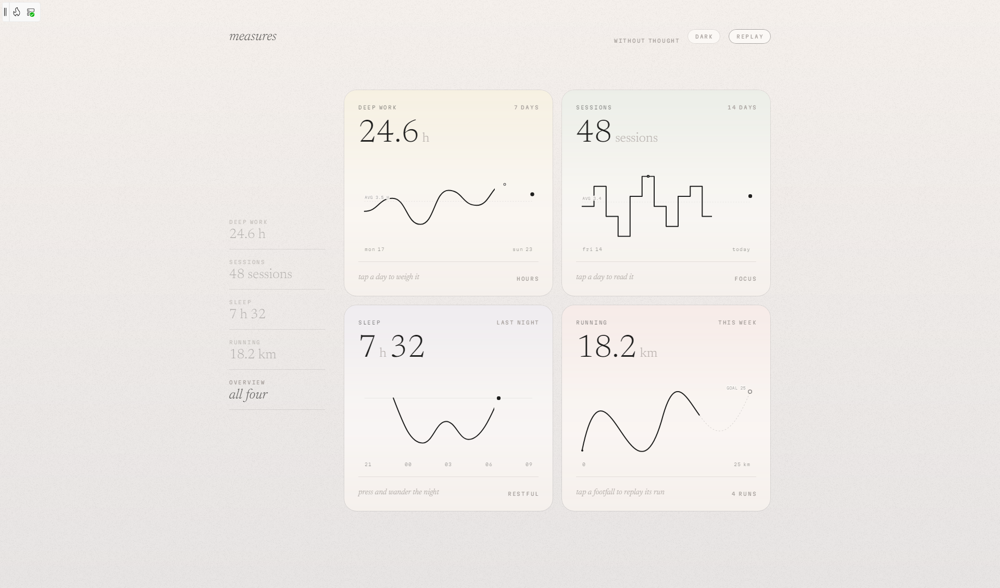

# Measures

An Uno Platform port of an HTML prototype (`prototype/ethereal-measures.html`): one page of four personal-data cards, each with its own hand-drawn chart and one gesture. The data is static sample data in `Measures/Data/SampleData.cs`.



## What's in it

| Card | Chart | Gesture |
|---|---|---|
| Deep work | `RidgeChart`, smooth curve over 7 or 14 days | Tap a day to pin its reading |
| Sessions | `StepChart`, step line of sessions per day | Tap a day to read it |
| Sleep | `NightChart`, depth curve across the night | Press and drag to scrub |
| Running | `RoadChart`, weekly distance toward a goal | Tap a footfall to replay that run |

The cards sit in a `FlipView` carousel with a fifth "overview" stop showing all four as tiles. Three layouts: narrow (< 620) with pips, medium, and wide (>= 1100) with an index rail. The header has Dark/Light and Replay buttons.

| Path | Purpose |
|---|---|
| `Measures/` | The app: `MeasuresPage`, `Charts/`, `Controls/` (`MeasureCard`, `CaptionPresenter`, `RangeSwitch`, ...), `Motion/`, `Theming/`, `Tokens.xaml` |
| `Measures.Tests/` | NUnit + FluentAssertions tests for the cubic sampler, curves and data models |
| `prototype/` | The HTML prototype the port follows |
| `docs/MEASURES-BRIEFS.md` | Architecture, design and interaction spec; `docs/deltas/` holds the follow-up change briefs |
| `docs/glyph-field-background.md` | Spec for a glyph-grid background control (not implemented in the app) |
| `tools/` | Windows PowerShell scripts to build, launch, drive and capture the desktop app; `sf-stats.py` reads Android frame stats; `shots/` holds verification captures |

## Tech

- Uno Platform single project, `Uno.Sdk` 6.6.42 (`global.json`), Skia renderer
- Targets: `net10.0-desktop`, `net10.0-android`, plus `net10.0` for the test project
- No MVVM or MVUX: charts are templated controls (`Themes/Generic.xaml`) fed plain records through dependency properties; interaction state lives in each control
- Charts are XAML `Path`/`Ellipse`/`Line` with geometry computed in code (`CubicSampler`, `Curves`)
- Fonts: static Newsreader Light / Light Italic and Martian Mono TTFs
- `MEASURES_THEME=dark|light` forces the theme at launch; `-p:FrameWatch=true` keeps a per-second frame log in Release builds

## Run it

Requires the .NET 10 SDK. From the repo root:

```
dotnet run --project Measures/Measures.csproj -f net10.0-desktop
dotnet test Measures.Tests/Measures.Tests.csproj
```

Android (device attached):

```
dotnet build Measures/Measures.csproj -f net10.0-android -t:Install
```

On Windows, `tools/Verify.ps1 -Name check` stops, builds, launches and captures the desktop app.

## Status

Desktop build and 24 unit tests passed as of `HANDOFF.md` (2026-08-27). The Android head had not been rebuilt since the carousel and overview change because of a local build failure.
